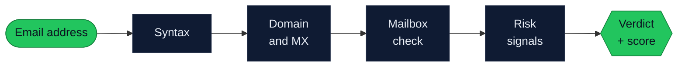

<a href="https://yeswecheck.fr/uk">
  <picture>
    <source media="(prefers-color-scheme: dark)" srcset=".github/assets/banner-dark.svg">
    
  </picture>
</a>

<p align="center">
  <a href="https://github.com/YesWeCheck/yeswecheck/actions/workflows/ci.yml"></a>
  <a href="https://www.npmjs.com/package/@yeswecheck/sdk"></a>
  <a href="https://docs.yeswecheck.fr/uk"></a>
  <a href="openapi/openapi.yaml"></a>
  <a href="integrations/mcp/"></a>
  <a href="https://app.yeswecheck.fr/uk/register?src=github"></a>
  <a href="LICENSE"></a>
</p>

<p align="center">
  <b>Know which email addresses are real before you send a single message.</b><br>
  Syntax, domain and mailbox checks, typo correction and risk signals, in one API call.
</p>

<p align="center">
  <a href="https://app.yeswecheck.fr/uk/register?src=github"><b>Get a free API key</b></a> ·
  <a href="docs/quickstart.md">Quickstart</a> ·
  <a href="#sdks-and-cli">SDKs</a> ·
  <a href="docs/README.md">Docs</a> ·
  <a href="https://yeswecheck.fr/uk">Website</a> ·
  <a href="https://status.yeswecheck.fr/uk">Status</a>
</p>

<br>

## Why YesWeCheck

<table>
  <tr>
    <td width="33%" valign="top">
      <h3>📬 Mailbox-level checks</h3>
      Goes beyond syntax and DNS: the recipient's mail server confirms whether the mailbox exists.
    </td>
    <td width="33%" valign="top">
      <h3>✨ Typo correction</h3>
      <code>gmial.com</code> → <code>gmail.com</code>. Catch mistakes at sign-up and suggest the fix to your user.
    </td>
    <td width="33%" valign="top">
      <h3>🛡️ Risk signals</h3>
      Disposable, malicious and lookalike domains, role and no-reply addresses, all flagged in <code>warnings</code>.
    </td>
  </tr>
  <tr>
    <td width="33%" valign="top">
      <h3>💳 Fair billing</h3>
      Only a conclusive mailbox check uses a credit. <code>unknown</code> results and every other check are free.
    </td>
    <td width="33%" valign="top">
      <h3>🧠 Your rules</h3>
      Allowlists, blocklists and policies per key: get a ready-made <code>accepted</code> / <code>rejected</code> decision.
    </td>
    <td width="33%" valign="top">
      <h3>🇫🇷 Hosted in France</h3>
      EU data hosting, stored addresses encrypted, results deleted automatically after a bulk job.
    </td>
  </tr>
</table>

## Quickstart

**1.** [Create a free account](https://app.yeswecheck.fr/uk/register?src=github) (100 welcome credits, no card) and create an API key.

**2.** Verify an address:

```bash
curl https://api.yeswecheck.fr/v2/email/validate \
  -H "Authorization: Bearer $YWC_API_KEY" \
  -H "Content-Type: application/json" \
  -d '{"email": "jane.doe@company.co.uk"}'
```

**3.** Act on the verdict:

```jsonc
{
  "result": "valid",          // valid | risky | invalid | unknown
  "score": 100,               // confidence, 0–100
  "disposable": false,
  "freeProvider": false,
  "businessEmail": true,
  "finalDecision": "accepted", // your key's policy, if you set one
  "features": {                // the detail of every check
    "smtp": { "result": "valid", "reasonCode": "MAILBOX_EXISTS" }
    // syntax, dns, disposable, typoDomain…
  },
  "metadata": { "credits": { "used": 1, "remaining": 4819 }, "apiVersion": "2.0" }
}
```

<details>
<summary><b>Node.js</b></summary>

```js
const res = await fetch("https://api.yeswecheck.fr/v2/email/validate", {
  method: "POST",
  headers: {
    Authorization: `Bearer ${process.env.YWC_API_KEY}`,
    "Content-Type": "application/json",
    "Accept-Language": "en-GB",
  },
  body: JSON.stringify({ email: "jane.doe@company.co.uk" }),
});

if (!res.ok) throw new Error(`YesWeCheck ${res.status}`);
const { result, score } = await res.json();
```

</details>

<details>
<summary><b>Python</b></summary>

```python
import os
import requests

res = requests.post(
    "https://api.yeswecheck.fr/v2/email/validate",
    headers={
        "Authorization": f"Bearer {os.environ['YWC_API_KEY']}",
        "Accept-Language": "en-GB",
    },
    json={"email": "jane.doe@company.co.uk"},
    timeout=30,
)
res.raise_for_status()
verdict = res.json()
print(verdict["result"], verdict["score"])
```

</details>

<details>
<summary><b>PHP</b></summary>

```php
$ch = curl_init('https://api.yeswecheck.fr/v2/email/validate');
curl_setopt_array($ch, [
    CURLOPT_RETURNTRANSFER => true,
    CURLOPT_POST => true,
    CURLOPT_TIMEOUT => 30,
    CURLOPT_HTTPHEADER => [
        'Authorization: Bearer ' . getenv('YWC_API_KEY'),
        'Content-Type: application/json',
        'Accept-Language: en-GB',
    ],
    CURLOPT_POSTFIELDS => json_encode(['email' => 'jane.doe@company.co.uk']),
]);
$verdict = json_decode(curl_exec($ch), true);
echo $verdict['result'] . ' ' . $verdict['score'];
```

</details>

## How it works



Each check is reported in `features`, so you always know *why* an address got its verdict. The mailbox check runs only on keys where you enable it.

| Verdict | Meaning | Typical action |
|---|---|---|
| 🟢&nbsp;`valid` | Deliverable, no notable risk signal | Accept |
| 🟠&nbsp;`risky` | Deliverable, but disposable, lookalike, malicious, no-reply, or low score | Accept with care, or reject on sensitive forms |
| 🔴&nbsp;`invalid` | Will not receive mail: bad syntax, no mail server, mailbox rejected | Reject, show the typo suggestion if any |
| ⚪&nbsp;`unknown` | The mail server did not allow a conclusion. **Never billed** | Accept and monitor |

More in [Verdicts and score](docs/verdicts.md) and [Response](docs/response.md).

## SDKs and CLI

<p align="center">
  
</p>

| | Package | Install |
|---|---|---|
| 🟨 | [**JavaScript / TypeScript SDK**](packages/js/): typed, zero dependencies, Node, Bun, Deno and edge | `npm i @yeswecheck/sdk` |
| ⌨️ | [**Command-line tool**](packages/cli/): one address or a whole CSV, from your terminal | `npx yeswecheck <email>` |

```ts
import { YesWeCheck, suggestedEmail } from "@yeswecheck/sdk";

const ywc = new YesWeCheck(); // reads YWC_API_KEY
const res = await ywc.validate("jane.doe@gmial.com");

if (res.result === "invalid") {
  const fix = suggestedEmail(res); // "jane.doe@gmail.com": ask "Did you mean…?"
}
```

Another language? The [OpenAPI specification](openapi/) generates a client in seconds.

## Integrations

<table>
  <tr>
    <td width="25%" valign="top">
      <h4>🤖 AI assistants</h4>
      <a href="integrations/mcp/"></a> <a href="integrations/mcp/"></a> <a href="integrations/mcp/"></a> <a href="integrations/mcp/"></a> <a href="integrations/mcp/"></a><br>
      MCP server with one-click install for Cursor and VS Code.<br>
      <a href="integrations/mcp/">Set up →</a>
    </td>
    <td width="25%" valign="top">
      <h4>⚙️ Automation</h4>
      <a href="integrations/make/"></a><br>
      The official Make app, plus recipes for Zapier and n8n.<br>
      <a href="integrations/">Browse →</a>
    </td>
    <td width="25%" valign="top">
      <h4>📇 CRM and email tools</h4>
      <a href="integrations/connectors/hubspot.md"></a> <a href="integrations/connectors/brevo.md"></a> <a href="integrations/connectors/mailchimp.md"></a> <a href="integrations/connectors/klaviyo.md"></a> <a href="integrations/connectors/mailjet.md"></a> <a href="integrations/connectors/pipedrive.md"></a> <a href="integrations/connectors/google-sheets.md"></a> <a href="integrations/connectors/systeme-io.md"></a> <a href="integrations/connectors/positive-user.md"></a><br>
      Clean lists in place, verdict written on every contact.<br>
      <a href="integrations/connectors/">Browse →</a>
    </td>
    <td width="25%" valign="top">
      <h4>📝 Form widget</h4>
      Real-time checks on any sign-up form, one script tag, no key in the page.<br>
      <a href="integrations/widget/">Set up →</a>
    </td>
  </tr>
</table>

## Best practices

> [!TIP]
> **Test for free.** A key without the mailbox check uses no credits: syntax, DNS, disposable, typo and lookalike checks are all free.

- **Branch on `result`**, and use `finalDecision` when you want your key's policy to decide for you.
- **One key per use case.** For example, a key without SMTP for instant checks while the user types, and a key with SMTP when the form is submitted.
- **Keep API keys on your server.** In the browser, use the [form widget](integrations/widget/): it needs no key in the page.
- **Treat `unknown` kindly.** It is not a failure and costs nothing: accept the address and keep an eye on bounces.
- **Store results.** An address rarely changes state overnight: keep verdicts for a while and skip repeat checks.

See the [production checklist](docs/guides/production-checklist.md) before going live.

## What's in this repository

| Path | Content |
|---|---|
| [`docs/`](docs/) | The documentation in Markdown: quickstart, verdicts, response, errors, limits, credits, guides |
| [`openapi/`](openapi/) | The OpenAPI 3.0 specification of the public API |
| [`packages/js/`](packages/js/) | `@yeswecheck/sdk`, the JavaScript and TypeScript SDK |
| [`packages/cli/`](packages/cli/) | `yeswecheck`, the command-line tool |
| [`integrations/`](integrations/) | MCP server setup and `server.json`, Make app, CRM connectors, form widget, Zapier and n8n |

## Pricing

Start with **100 free credits**, no card required. Only a conclusive mailbox check uses a credit; packs never expire. See [pricing](https://yeswecheck.fr/uk/pricing).

## Support

- 📖 [Documentation](https://docs.yeswecheck.fr/uk) and [FAQ](docs/faq.md)
- 🐛 [Report a problem](https://github.com/YesWeCheck/yeswecheck/issues/new/choose) with this repository
- ✉️ [contact@yeswecheck.fr](mailto:contact@yeswecheck.fr) for anything about your account
- 🔒 Security issue? See [SECURITY.md](SECURITY.md)

## Licence

The code and examples in this repository are released under the [MIT licence](LICENSE). The YesWeCheck API itself is a hosted service subject to its [terms](https://yeswecheck.fr/uk/terms).

<br>

<p align="center">
  <a href="https://yeswecheck.fr/uk"></a><br>
  <sub>Made in France · <a href="https://yeswecheck.fr/uk">yeswecheck.fr</a></sub>
</p>
