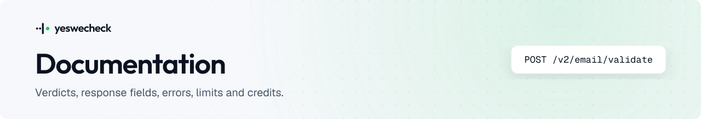

<picture>
  <source media="(prefers-color-scheme: dark)" srcset="../.github/assets/header-docs-dark.svg">
  
</picture>

  <a href="quickstart.md">Quickstart</a> ·
  <a href="../openapi/openapi.yaml">OpenAPI</a> ·
  <a href="https://docs.yeswecheck.fr/uk">Full documentation</a> ·
  <a href="https://app.yeswecheck.fr/uk/register?src=github">Get an API key</a>

Everything you need to call the YesWeCheck API, in plain Markdown. This is a developer-friendly mirror of [docs.yeswecheck.fr](https://docs.yeswecheck.fr/uk), which remains the reference.

## Start here

| | Page | What you will learn |
|---|---|---|
| 🚀 | [Quickstart](quickstart.md) | Create a key, verify your first address and read the verdict in five minutes |
| 🔑 | [Authentication](authentication.md) | Bearer keys, active checks, IP and origin restrictions, caps, rotation |
| 🧭 | [Verdicts and score](verdicts.md) | How `valid`, `risky`, `invalid` and `unknown` are reached, and how to read the score |

## Reference

| | Page | What you will learn |
|---|---|---|
| 🧩 | [Response](response.md) | Every field of the response, check by check |
| 🔍 | [Checks](checks.md) | What is checked, what is free, how to toggle each check per key |
| ⚠️ | [Errors](errors.md) | HTTP codes, machine-readable `code` values and how to handle them |
| ⏱️ | [Rate limits](rate-limits.md) | Limits per endpoint and per key, `RateLimit` headers |
| 💳 | [Credits](credits.md) | The billing rule, balance tracking and the `402` response |
| 📄 | [OpenAPI](../openapi/openapi.yaml) | The machine-readable specification (OpenAPI 3.0) |

## Guides

| | Guide | Use it when |
|---|---|---|
| ✍️ | [Sign-up validation](guides/signup-validation.md) | You verify addresses as users sign up or check out |
| ⌨️ | [Autocomplete](guides/autocomplete.md) | You want domain suggestions and typo fixes while users type |
| 📋 | [Bulk lists](guides/bulk-lists.md) | You clean an existing list of up to 500,000 addresses |
| 🛡️ | [Policies and lists](guides/policies-and-lists.md) | You need stricter business rules, allowlists or blocklists |
| ✅ | [Production checklist](guides/production-checklist.md) | You are about to go live |
| ❓ | [FAQ](faq.md) | You have a question that is not answered above |
