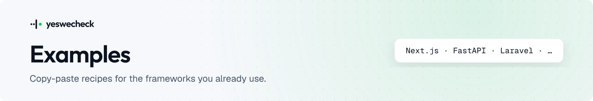

<picture>
  <source media="(prefers-color-scheme: dark)" srcset="../.github/assets/header-examples-dark.svg">
  
</picture>

  <a href="#recipes">Recipes</a> ·
  <a href="#the-same-rules-everywhere">Rules</a> ·
  <a href="#run-a-recipe">Run one</a> ·
  <a href="../tools/">API tools</a>

Small, complete recipes that verify an email address where your users type it: a sign-up form, an API route, a validation schema. Each one runs on its own, takes a few minutes to read, and is meant to be copied into your project.

## Recipes

<table>
  <tr>
    <td width="72" align="center"></td>
    <td><b><a href="nextjs-signup/">Next.js sign-up form</a></b> Server Action with <code>useActionState</code>, "Did you mean…?" in one click, optional widget.</td>
    <td width="72" align="center"></td>
    <td><b><a href="express-middleware/">Express middleware</a></b> <code>requireDeliverableEmail()</code> in front of any route, 422 with the fix.</td>
  </tr>
  <tr>
    <td align="center"></td>
    <td><b><a href="nestjs/">NestJS pipe</a></b> <code>@Body("email", DeliverableEmailPipe)</code>, the client injected once for the whole app.</td>
    <td align="center"></td>
    <td><b><a href="zod-refinement/">Zod schema</a></b> An async refinement that only calls the API once the format is right.</td>
  </tr>
  <tr>
    <td align="center"></td>
    <td><b><a href="fastapi/">FastAPI endpoint</a></b> One shared <code>httpx.AsyncClient</code> opened in the lifespan.</td>
    <td align="center"></td>
    <td><b><a href="django/">Django form</a></b> <code>clean_email()</code> on a regular form, with a button to accept the fix.</td>
  </tr>
  <tr>
    <td align="center"></td>
    <td><b><a href="laravel/">Laravel rule</a></b> A <code>ValidationRule</code> class, after <code>bail</code> and <code>email</code>.</td>
    <td align="center"></td>
    <td><b><a href="curl/">curl</a></b> Every endpoint from a terminal, with the answers to expect.</td>
  </tr>
</table>

Want to call the API by hand first? The [Postman and Bruno collections](../tools/) contain every request.

## The same rules everywhere

Every recipe turns the verdict into one of three outcomes, in this order:

| The API says | The recipe | Why |
|---|---|---|
| `finalDecision: "rejected"` | Refuses | The policy you set on your key in the dashboard has the last word |
| A typo was found (`gmial.com`) | Refuses, and offers the fix | One click and the user is back on track: the most common fix of all |
| `invalid` | Refuses | The address cannot receive email |
| `risky` and `disposable` | Refuses | A temporary inbox, gone in a few minutes |
| `risky`, other signals | Accepts, flagged `risky` | No-reply or lookalike address: worth a look, not worth losing a customer |
| `unknown` | Accepts, flagged `unconfirmed` | The mail server gave no answer. Never billed |
| Valid | Accepts | |
| API unreachable, no credits, bad key | Accepts, flagged `unchecked`, and logs the error | Verification must never stop a real customer from signing up |

Adapt the `risky` and `unknown` rows to your context: a payment form may refuse every `risky` address, a newsletter may accept everything except `invalid`. See [verdicts](../docs/verdicts.md) for the full picture.

> [!TIP]
> **Use two keys.** While the user types, a key without the mailbox check is free and instant (syntax, domain, disposable and typo checks). When the form is submitted, a key with the mailbox check confirms the address for 1 credit.

## Run a recipe

1. Get a free API key: [app.yeswecheck.fr/uk/register](https://app.yeswecheck.fr/uk/register?src=github-examples) (100 credits included).
2. Open the recipe's folder and follow its README. Every recipe reads the key from the `YWC_API_KEY` environment variable, or from a `.env` file (copy `.env.example`).
3. Try these addresses:

| Address | What happens |
|---|---|
| your own address | Accepted |
| an address at `gmial.com` or `hotnail.com` | Refused, with the corrected address offered |
| an address at a temporary inbox service | Refused: temporary address |
| `nobody@` followed by your company's domain | Refused when the mail server says the mailbox does not exist |

> [!IMPORTANT]
> Keep your API key on the server. Each recipe calls the API from the back end: a key placed in a web page can be read by anyone. In the browser, use the [form widget](../integrations/widget/), which needs no key.

## Licence

The examples are released under the [MIT licence](../LICENSE): copy them, change them, ship them.
