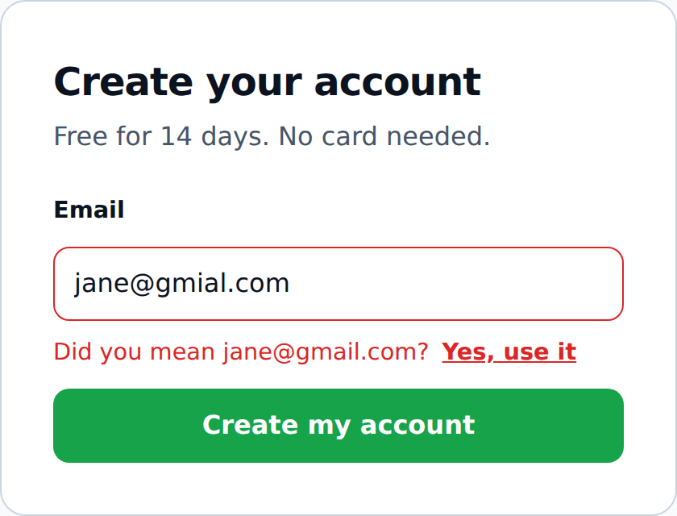

<sub><a href="../../README.md">YesWeCheck</a> › <a href="../README.md">Examples</a> › Next.js</sub>

# Next.js sign-up form

A sign-up form that refuses undeliverable and temporary addresses, and turns a typo into a one-click fix. The check runs in a Server Action, so the API key never reaches the browser.

<p align="center">
  <picture>
    <source media="(prefers-color-scheme: dark)" srcset="../../.github/assets/examples/nextjs-signup-dark.png">
    
  </picture>
</p>

**Stack:** Next.js 16 (App Router), React 19, [`@yeswecheck/sdk`](../../packages/js/).

## Files

| File | Role |
|---|---|
| [`lib/email-check.ts`](lib/email-check.ts) | Calls the API and turns the verdict into a decision. **The file to copy.** |
| [`app/actions.ts`](app/actions.ts) | The Server Action: reads the form, checks the address, creates the account |
| [`app/signup-form.tsx`](app/signup-form.tsx) | The form, with `useActionState` and the "Yes, use it" button |
| [`app/layout.tsx`](app/layout.tsx) | Loads the optional widget |

## Run it

```bash
cp .env.example .env.local   # then paste your API key
npm install
npm run dev
```

Open http://localhost:3000 and try an address at `gmial.com`.

## How it works

```ts
// app/actions.ts
export async function signup(_prev: SignupState, formData: FormData): Promise<SignupState> {
  const email = String(formData.get("suggestion") ?? formData.get("email") ?? "").trim();
  const check = await checkEmail(email);
  if (!check.ok) return { status: "error", email, message: check.message, suggestion: check.suggestion };
  // create the account…
  return { status: "done", email: check.email, flag: check.flag };
}
```

- **One-click fix.** The "Yes, use it" button submits the form with `name="suggestion"`, so the action receives the corrected address and checks it again.
- **The typed value stays.** React resets the form after an action; `defaultValue={state.email}` puts the address back so the user can edit it.
- **Never blocking.** If the API cannot be reached, `checkEmail()` logs the error and lets the sign-up through, flagged `unchecked`.

## Add the widget (optional)

Set `NEXT_PUBLIC_YWC_WIDGET_ID` to a widget's public ID ([create one](../../integrations/widget/#install)) and the address is checked while the user types, with domain suggestions after the `@`. The Server Action still checks it on submit: a bot can post the form without running any JavaScript.

> [!TIP]
> When the widget runs the mailbox check, a server key **without** SMTP is enough for the submit: it is free and still catches bots (malformed, temporary or dead-domain addresses).

## Adapt it

- Change the `risky` and `unknown` branches of `decide()` in [`lib/email-check.ts`](lib/email-check.ts) to suit your form. The [rules shared by every recipe](../README.md#the-same-rules-everywhere) explain each case.
- Save `check.flag` on the user record to review `risky`, `unconfirmed` and `unchecked` sign-ups later.
