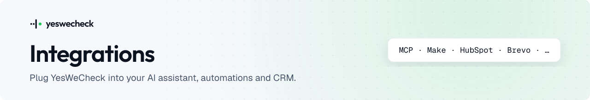

<picture>
  <source media="(prefers-color-scheme: dark)" srcset="../.github/assets/header-integrations-dark.svg">
  
</picture>

<p align="center">
  <a href="#ai-assistants">AI assistants</a> ·
  <a href="#automation">Automation</a> ·
  <a href="#crm-and-email-tools">CRM and email tools</a> ·
  <a href="#websites-and-forms">Forms</a> ·
  <a href="../README.md#sdks-and-cli">SDKs</a>
</p>

Use YesWeCheck where your addresses already live. Every integration follows the same rules as the API: the same checks, the same verdicts, and the same credits (a credit only for a conclusive mailbox check).

## AI assistants

<table>
  <tr>
    <td width="96" align="center"><a href="mcp/"></a></td>
    <td width="96" align="center"><a href="mcp/"></a></td>
    <td width="96" align="center"><a href="mcp/"></a></td>
    <td width="96" align="center"><a href="mcp/"></a></td>
    <td width="96" align="center"><a href="mcp/"></a></td>
  </tr>
  <tr>
    <td align="center"><sub>Claude &amp; Claude&nbsp;Code</sub></td>
    <td align="center"><sub>ChatGPT</sub></td>
    <td align="center"><sub>Le Chat</sub></td>
    <td align="center"><sub>Cursor</sub></td>
    <td align="center"><sub>VS Code</sub></td>
  </tr>
</table>

The [**MCP server**](mcp/) gives any MCP-compatible assistant eight tools: verify an address, clean a list of up to 5,000 addresses, follow a bulk job, find a person's work email, check your credits. Connect in one click with OAuth, or with a dedicated key for agents and CI.

```text
https://api.yeswecheck.fr/mcp
```

## Automation

<table>
  <tr>
    <td width="96" align="center"><a href="make/"></a></td>
    <td valign="middle"><b><a href="make/">Make</a></b>: the official YesWeCheck app. Verify an address, read your balance or call any endpoint, with outputs ready to map. No code.</td>
  </tr>
  <tr>
    <td align="center">⚡</td>
    <td valign="middle"><b><a href="no-code.md">Zapier, n8n and any HTTP tool</a></b>: one HTTP request, ready-made settings, and an n8n AI agent recipe.</td>
  </tr>
</table>

## CRM and email tools

Native [connectors](connectors/) clean your lists in place and write the verdict on every contact. Most of them can also verify new contacts automatically as they arrive.

<table>
  <tr>
    <td width="20%" align="center"><a href="connectors/hubspot.md"></a><br><sub>HubSpot</sub></td>
    <td width="20%" align="center"><a href="connectors/brevo.md"></a><br><sub>Brevo</sub></td>
    <td width="20%" align="center"><a href="connectors/mailchimp.md"></a><br><sub>Mailchimp</sub></td>
    <td width="20%" align="center"><a href="connectors/klaviyo.md"></a><br><sub>Klaviyo</sub></td>
    <td width="20%" align="center"><a href="connectors/mailjet.md"></a><br><sub>Mailjet</sub></td>
  </tr>
  <tr>
    <td align="center"><a href="connectors/pipedrive.md"></a><br><sub>Pipedrive</sub></td>
    <td align="center"><a href="connectors/google-sheets.md"></a><br><sub>Google Sheets</sub></td>
    <td align="center"><a href="connectors/systeme-io.md"></a><br><sub>Systeme.io</sub></td>
    <td align="center"><a href="connectors/positive-user.md"></a><br><sub>Positive User</sub></td>
    <td align="center"><a href="https://github.com/YesWeCheck/yeswecheck/issues/new?template=integration-request.yml">➕</a><br><sub><a href="https://github.com/YesWeCheck/yeswecheck/issues/new?template=integration-request.yml">Request one</a></sub></td>
  </tr>
</table>

## Websites and forms

The [**form widget**](widget/) checks addresses as visitors type: domain suggestions, typo fixes, and submission blocked when the address is unusable. One script tag, no API key in the page.

```html
<script async src="https://api.yeswecheck.fr/widget/ywc-email-widget.js" data-ywc-widget="YOUR_WIDGET_ID"></script>
```

## Something else?

- Call the API from your own code with the [SDKs and CLI](../README.md#sdks-and-cli), or any language with the [OpenAPI specification](../openapi/).
- Missing a tool? [Request an integration](https://github.com/YesWeCheck/yeswecheck/issues/new?template=integration-request.yml).
