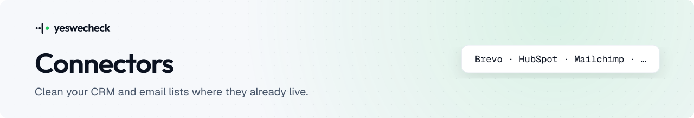

<picture>
  <source media="(prefers-color-scheme: dark)" srcset="../../.github/assets/header-connectors-dark.svg">
  
</picture>

<a href="../../README.md">YesWeCheck</a> › <a href="../README.md">Integrations</a> › Connectors · <a href="https://docs.yeswecheck.fr/uk/connectors">Full documentation</a>

# Connectors

A connector links YesWeCheck to the tool that holds your contacts. You verify a list without exporting or re-importing it: YesWeCheck reads the contacts, verifies them and writes the result on each contact, inside the tool.

Available connectors: [Brevo](brevo.md), [HubSpot](hubspot.md), [Pipedrive](pipedrive.md), [Mailchimp](mailchimp.md), [Positive User](positive-user.md) (User.com), [Mailjet](mailjet.md), [Klaviyo](klaviyo.md), [Systeme.io](systeme-io.md) and [Google Sheets](google-sheets.md). To use YesWeCheck from Claude, ChatGPT, Le Chat or an agent, see [AI assistants](../mcp/README.md); from your automation scenarios, see [Make](../make/README.md).

    

## What a connector does

| Function | Detail |
|---|---|
| Clean a list | You choose a list, an audience, a segment, a filter or the whole account. The contacts are verified like a [batch](../../docs/guides/bulk-lists.md), then the result is written on each contact. |
| Write the result | Four fields per contact: verdict, score, reason and verification date. In Google Sheets, these are four columns added to the right of your data; in Mailchimp, you can choose one tag per verdict instead. |
| Group invalid contacts | Optional: `invalid` contacts are added to a dedicated list (a label in Pipedrive, a tag in Mailchimp, Positive User and Systeme.io), so you can exclude them from your sends. |
| Block invalid contacts | Optional, off by default: `invalid` contacts are blocklisted (Brevo) or unsubscribed (HubSpot, Mailchimp, Positive User, Mailjet). In Mailchimp, they can also be archived; in Positive User, their address can also be banned; in Mailjet, they can also be excluded from campaigns. In Klaviyo, they can be removed from the cleaned list or suppressed (no more marketing emails, not counted in active profiles). In Systeme.io, an automation rule triggered by the invalid-addresses tag unsubscribes them from your campaigns. |
| Verify a contact | From the connector page: an address you enter is looked up in the tool, verified, and its result written on the contact's record. |
| Verify new contacts | Optional, off by default: each contact added to a monitored list is verified, within a minute with Brevo and within 5 minutes with HubSpot; with Pipedrive, each new person, within 5 minutes; with Mailchimp, each new subscriber to a monitored audience, within 5 minutes; with Positive User, each contact created with an address in a monitored source, within 5 minutes; with Mailjet, each new contact or each addition to a monitored list, within 5 minutes; with Klaviyo, each new profile or each entry into a monitored list or segment, within 5 minutes; with Systeme.io, each new contact or each contact that receives a monitored tag, within a few minutes; with Google Sheets, each row added at the bottom of a monitored sheet, within 5 minutes. |

A connector **never** deletes a contact and sends **no** email. Optional Mailchimp archiving can be undone from Mailchimp.

## What is written on each contact

| Field | Content |
|---|---|
| Status | `valid`, `risky`, `invalid` or `unknown` — see [verdicts](../../docs/verdicts.md) |
| Score | 0 to 100 |
| Reason | Main reason, or empty if there is nothing to report (table below) |
| Date | Day of the verification |

Possible reason values:

| Reason | Meaning |
|---|---|
| `syntax` | Malformed address |
| `no_mx` | The domain does not receive email |
| `blacklisted` | Address in your YesWeCheck blocklist |
| `disposable` | Disposable address |
| `typosquat` | Trap domain imitating a well-known domain |
| `typo` | Probable typo in the domain |
| `malicious_domain` | Malicious domain |
| `mailbox_not_found` | The server rejected the mailbox |
| `catch_all` | Domain that accepts every address: mailbox cannot be confirmed |
| `role_account` | Generic address (contact@, info@…) |
| `random_string` | Random local part |
| `unverifiable` | Verification not possible for now |

When a list is cleaned again, only contacts whose verdict has changed are rewritten. An unchanged verdict is rewritten after 90 days, to refresh its date.

## Credits

The rules are those of [batch processing](../../docs/credits.md): with SMTP enabled (the default), one credit per verified contact, unless the verdict is `unknown`. The following are neither verified nor billed:

- duplicates;
- contacts without an address;
- contacts already blocked or unsubscribed (option on by default).

Automatic verification of new contacts follows the same rule, with a daily limit that you set. **Verify a contact** costs one credit, unless the verdict is `unknown`; an address not found in the tool is not verified and costs nothing.

## Security

- The tool's key is tested when you connect, then stored **encrypted**. It is never shown again, nor logged.
- Only the organisation's owners and administrators can connect, configure or disconnect a tool.
- **Disconnect** erases the key and removes automatic verification from the tool. Fields already written stay on your contacts.
- If the tool rejects the key (key revoked or expired, IP address restriction), the connection switches to **Reconnect needed** and a notification alerts you. No call is made until the connection is set up again.
- Deleting your YesWeCheck account disconnects all tools.
