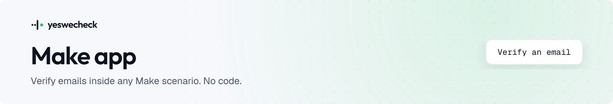

<picture>
  <source media="(prefers-color-scheme: dark)" srcset="../../.github/assets/header-make-dark.svg">
  
</picture>

<a href="../../README.md">YesWeCheck</a> › <a href="../README.md">Integrations</a> › Make · <a href="https://docs.yeswecheck.fr/uk/connectors/make">Full documentation</a>

# Make

The YesWeCheck app for [Make](https://www.make.com) adds address verification to your scenarios: a form, a lead or a spreadsheet row goes through YesWeCheck, and the rest of the scenario depends on the verdict. It applies the settings of the key in use (checks, SMTP, validation policy, lists) and debits the same credits as the API.

## 1. Create a Make key

In the dashboard: **Integrate → Integrations → Make**, under **Create a Make key**.

| Setting | Advice |
|---|---|
| Use | One name per scenario or per client, for example `CRM`: the key is named “Make – CRM”. |
| Daily credit cap | Keep a cap: a looping scenario won't drain your balance. |
| Mailbox check (SMTP) | When enabled, it confirms the mailbox exists: 1 credit per conclusive verification. |

Copy the key straight away: it won't be shown again. A Make key is an ordinary server key, without the `network` check (the IP address seen would be Make's, not the contact's) and without an origin restriction. It also appears under **API keys**, where you revoke or replace it.

## 2. Install the app in Make

1. In the dashboard, on the **Make** page, click **Open the app in Make** while signed in to Make, and install the YesWeCheck app in your organisation.
2. In a scenario, add a module and search for **YesWeCheck**.
3. On the first module, click **Create a connection** and paste the key. Make checks the key and shows your organisation's name and the key's name.

A rejected key shows “[401] Invalid or revoked API key”: check that it starts with `ywc_live_` (or `ywc_test_`) and has not been revoked.

## 3. The modules

| Module | Role | Credits |
|---|---|---|
| **Verify an email address** | Checks one address and returns the verdict, the score and the detail of each check. | As with [the API](../../docs/credits.md): 1 credit only if the key has SMTP and the verdict is not `unknown` |
| **Get credit balance** | Organisation balance, key name, whether SMTP is on, the key's caps and usage (filled in when the key has a cap). | Free |
| **Make an API call** | Any call to the API, with a path relative to `https://api.yeswecheck.fr` (for example `/v2/me`). The key is already added. | Depends on the endpoint called |

### Verify an email address

Required field: **Email address**. Advanced fields: **Country** (reference country for first-name analysis, an ISO code such as `FR` or `GB`) and **Mailbox check timeout** (1,000 to 30,000 ms).

Main outputs, to map into the following modules:

| Output | Content |
|---|---|
| Result | `valid`, `risky`, `invalid` or `unknown` — see [verdicts](../../docs/verdicts.md) |
| Score (0-100) | Deliverability score |
| Free email provider, Business email, Disposable, Alias | Yes/no flags |
| Policy decision | `accepted` or `rejected`, per the key's validation policy |
| Checks | Detail of each check (`syntax`, `dns`, `smtp`…): result, score, reason code — see [checks](../../docs/checks.md) |
| Metadata | Request ID, verification date, credits used and remaining |

The output is exactly the [API response](../../docs/response.md).

## 4. Example scenario

1. Trigger: new form response, new lead or new row.
2. **YesWeCheck → Verify an email address**, with the email from the trigger.
3. A **Router** with one filter per branch on **Result**:
   - `valid`: create the contact in the CRM;
   - `invalid`: nothing, or an alert;
   - `risky` and `unknown`: create the contact with a “to check” tag.
4. Optional: store **Result**, **Score** and **Metadata → Checked at** on the contact record.

To watch the balance, a daily scheduled scenario with **Get credit balance** and a filter on **Credits → Balance** can send an alert.

## 5. Errors

| Message in Make | Cause | What to do |
|---|---|---|
| `[400] email must be an email` | Malformed address or empty field | Filter out empty values before the module |
| `[401] Invalid or revoked API key…` | Revoked or wrong key | Create a new key and update the connection |
| `[402] Not enough credits…` | Organisation balance too low for an SMTP verification | Top up credits — see [Insufficient balance](../../docs/credits.md#insufficient-balance-402) |
| `[429] …` | The key's call limit, or the key's credit cap reached (`API_KEY_BUDGET_EXCEEDED`) | Make handles it as a rate limit, without turning the scenario off. For a cap, wait for the reset (00:00 UTC) or raise it. See [Rate limits](../../docs/rate-limits.md) and [Credit caps](../../docs/authentication.md#credit-caps) |

Other codes are described in [Errors](../../docs/errors.md).
