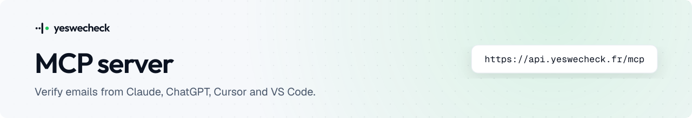

<picture>
  <source media="(prefers-color-scheme: dark)" srcset="../../.github/assets/header-mcp-dark.svg">
  
</picture>

<sub><a href="../../README.md">YesWeCheck</a> › <a href="../README.md">Integrations</a> › AI assistants (MCP) · <a href="https://docs.yeswecheck.fr/uk/connectors/mcp">Full documentation</a></sub>

# AI assistants (MCP server)

The YesWeCheck MCP server gives your AI assistant tools to verify addresses and find B2B emails. You talk to it as usual, and it calls YesWeCheck when useful. It applies your account settings (checks, SMTP, validation policy, lists) and uses the same credits.

```text
https://api.yeswecheck.fr/mcp
```

The protocol is the [Model Context Protocol](https://modelcontextprotocol.io), over the *Streamable* HTTP transport. Any compatible MCP client can connect to it.

<p>     </p>

## What you can ask

- "Verify the address john.smith@acme.com."
- "Here are 300 addresses from a trade show: which ones are invalid?"
- "How many credits would this list cost?" (estimate, nothing is charged)
- "Find Jane Doe's work email at acme.com."
- "How is the clean-up I started this morning going?"
- "How many credits do I have left?"

## One-click install

<p>
  <a href="https://cursor.com/link/mcp/install?name=yeswecheck&config=eyJ1cmwiOiJodHRwczovL2FwaS55ZXN3ZWNoZWNrLmZyL21jcCJ9"></a>
  <a href="https://vscode.dev/redirect?url=vscode%3Amcp%2Finstall%3F%257B%2522name%2522%253A%2522yeswecheck%2522%252C%2522type%2522%253A%2522http%2522%252C%2522url%2522%253A%2522https%253A%2F%2Fapi.yeswecheck.fr%2Fmcp%2522%257D"></a>
</p>

```bash
# Claude Code
claude mcp add --transport http yeswecheck https://api.yeswecheck.fr/mcp
```

Each button opens the app with the server pre-filled; you then approve access on the YesWeCheck page (OAuth, no key to copy). The server is also described for MCP registries in [`server.json`](server.json).

## Install

Two ways to connect:

- **OAuth** (Claude, ChatGPT, Le Chat, Claude Code, Cursor, VS Code): you paste the server address, a YesWeCheck page opens, you choose the permissions and click **Approve**. No key to copy.
- **API key** (scripts, agents, CI, servers without a browser): a dedicated MCP key sent in the `Authorization` header. See [Connect with an API key](#connect-with-an-api-key).

The server address and these same steps are also in the customer area: **Integrate → Integrations → AI assistants**.

<details open>
<summary><b>Claude</b></summary>

1. In Claude (web or Desktop), open the **Connectors** menu and add a custom connector.
2. Name it `YesWeCheck` and paste the server address.
3. Click **Connect**: the YesWeCheck page opens; choose the permissions, then **Approve**.
4. Enable the connector in the conversation and ask your question.

On a Team or Enterprise plan, the connector must first be added by an owner of the Claude workspace.

</details>

<details>
<summary><b>ChatGPT</b></summary>

1. In ChatGPT, add a custom MCP server (Apps or Connectors section, in developer mode depending on your plan).
2. Paste the server address and choose **OAuth** authentication.
3. Sign in to YesWeCheck when the page opens, choose the permissions, then **Approve**.

Custom MCP servers depend on your ChatGPT plan and your workspace settings.

</details>

<details>
<summary><b>Le Chat (Mistral)</b></summary>

1. In Le Chat, open **Connectors**, click **Add connector**, then the **Custom MCP connector** tab.
2. Name it `YesWeCheck` and paste the server address: Le Chat detects the OAuth connection.
3. Sign in to YesWeCheck when the page opens, choose the permissions, then **Approve**.

In a Le Chat team workspace, only admins can add a custom connector.

</details>

<details>
<summary><b>Claude Code</b></summary>

```bash
claude mcp add --transport http yeswecheck https://api.yeswecheck.fr/mcp
```

In Claude Code, type `/mcp` then choose `yeswecheck`: the browser opens the YesWeCheck authorisation page.

Without a browser (server, CI), use an [API key](#connect-with-an-api-key).

</details>

<details>
<summary><b>Cursor</b></summary>

Add the server to Cursor's `mcp.json` file (MCP settings):

```json
{
  "mcpServers": {
    "yeswecheck": { "url": "https://api.yeswecheck.fr/mcp" }
  }
}
```

Cursor detects the OAuth connection: click **Connect**, then **Approve** on the YesWeCheck page.

</details>

<details>
<summary><b>VS Code</b></summary>

Add the server with the **MCP: Add Server** command, or in `.vscode/mcp.json`:

```json
{
  "servers": {
    "yeswecheck": { "type": "http", "url": "https://api.yeswecheck.fr/mcp" }
  }
}
```

Start the server: VS Code opens the YesWeCheck authorisation page.

</details>

## Authorise access

The authorisation page opens on [app.yeswecheck.fr](https://app.yeswecheck.fr/uk); sign in if needed, with your usual methods (password, Google, GitHub, two-factor authentication). It shows the app requesting access and the address you will be sent back to.

| Setting | Default | Effect |
|---|---|---|
| Organisation | The one in your session (**Switch account** for another) | The assistant acts for that organisation only |
| Verify email addresses | Always granted | Validation, batch tracking and credit tools |
| Find a person's work email | Ticked if the app requests it | `find_btob_email` tool |
| Mailbox check (SMTP) | On | 1 credit per address checked over SMTP (see [Credits](#credits-and-quotas)) |
| Daily credit limit | 500 (empty = no limit) | Beyond it, validations with SMTP from this connection are refused until the next day |

Only the organisation's **owners** and **admins** can authorise an app; a member can only deny.

On authorisation, YesWeCheck creates an **API key dedicated** to this app, named `MCP – <app name>`. It carries the chosen settings; its secret is never shown. You find it in **API keys**, with the **MCP · OAuth** badge, where you can change its checks, its limit or its IP restrictions as for any key.

The app receives an access token valid for one hour, renewed automatically for 30 days of use. An app inactive for more than 30 days must reconnect.

<a id="connect-with-an-api-key"></a>

## Connect with an API key

For a script, a server-side agent or continuous integration, create an **MCP key** in **Integrate → Integrations → AI assistants**, **Scripts and agents** tab: choose SMTP, B2B search and a daily limit. The `ywc_live_…` secret is shown only once.

One key per agent: it can be revoked on its own, without cutting off your other integrations. A regular API key works too, with its own settings; B2B search is enabled in the key, with the **B2B Email Finder for AI agents** option (**AI agents (MCP)** block, off by default).

<details open>
<summary><b>Claude Code</b></summary>

```bash
claude mcp add --transport http yeswecheck https://api.yeswecheck.fr/mcp \
  --header "Authorization: Bearer ywc_live_…"
```

Or, in the project's `.mcp.json` file, with the key in the `YWC_API_KEY` environment variable:

```json
{
  "mcpServers": {
    "yeswecheck": {
      "type": "http",
      "url": "https://api.yeswecheck.fr/mcp",
      "headers": { "Authorization": "Bearer ${YWC_API_KEY}" }
    }
  }
}
```

</details>

<details>
<summary><b>Cursor</b></summary>

```json
{
  "mcpServers": {
    "yeswecheck": {
      "url": "https://api.yeswecheck.fr/mcp",
      "headers": { "Authorization": "Bearer ${env:YWC_API_KEY}" }
    }
  }
}
```

</details>

<details>
<summary><b>VS Code</b></summary>

VS Code asks for the key on first start and keeps it in its secure storage:

```json
{
  "inputs": [
    { "type": "promptString", "id": "ywc-key", "description": "YesWeCheck MCP key", "password": true }
  ],
  "servers": {
    "yeswecheck": {
      "type": "http",
      "url": "https://api.yeswecheck.fr/mcp",
      "headers": { "Authorization": "Bearer ${input:ywc-key}" }
    }
  }
}
```

</details>

<details>
<summary><b>TypeScript</b></summary>

```js
// npm install @modelcontextprotocol/client
import { Client, StreamableHTTPClientTransport } from '@modelcontextprotocol/client';

const transport = new StreamableHTTPClientTransport(new URL('https://api.yeswecheck.fr/mcp'), {
  requestInit: { headers: { Authorization: `Bearer ${process.env.YWC_API_KEY}` } },
});
const client = new Client({ name: 'my-agent', version: '1.0.0' });
await client.connect(transport);

const result = await client.callTool({
  name: 'validate_email',
  arguments: { email: 'contact@example.com' },
});
console.log(result.structuredContent);
```

</details>

<details>
<summary><b>Python</b></summary>

```python
# pip install "mcp>=2"
import asyncio, os
import httpx2
from mcp import Client
from mcp.client.streamable_http import streamable_http_client

async def main() -> None:
    async with httpx2.AsyncClient(
        headers={"Authorization": f"Bearer {os.environ['YWC_API_KEY']}"},
        timeout=httpx2.Timeout(30.0, read=120.0),
    ) as http_client:
        transport = streamable_http_client("https://api.yeswecheck.fr/mcp", http_client=http_client)
        async with Client(transport) as client:
            result = await client.call_tool("validate_email", {"email": "contact@example.com"})
            print(result.structured_content)

asyncio.run(main())
```

</details>

<details>
<summary><b>n8n</b></summary>

In your n8n agent, add the **MCP Client Tool** tool:

| Parameter | Value |
|---|---|
| Address | `https://api.yeswecheck.fr/mcp` |
| Transport | HTTP Streamable |
| Authentication | Bearer, with the MCP key |

</details>

<details>
<summary><b>cURL</b></summary>

```bash
curl https://api.yeswecheck.fr/mcp \
  -H "Authorization: Bearer $YWC_API_KEY" \
  -H "Content-Type: application/json" \
  -H "Accept: application/json, text/event-stream" \
  -d '{"jsonrpc":"2.0","id":1,"method":"tools/list"}'
```

The response comes back in `text/event-stream` format (a single `data:` message).

</details>

The server only accepts `Authorization: Bearer`. A `widget`-scope key and a dashboard session token are refused (`401`/`403`).

## The tools

| Tool | Purpose | Cost | Read-only |
|---|---|---|---|
| `validate_email` | Verifies an address | 1 credit if SMTP and verdict ≠ `unknown` | No |
| `validate_emails_batch` | Verifies a list (up to 5,000 addresses) | Same, per address | No |
| `get_batch_job` | Progress of a batch | Free | Yes |
| `get_batch_results` | Results of a batch, page by page | Free | Yes |
| `list_batch_jobs` | Batches started by your assistants | Free | Yes |
| `cancel_batch_job` | Cancels a running batch | Refund of addresses without a conclusion | No |
| `find_btob_email` | Finds a person's work email | 1 search from the daily quota, no credits | No |
| `get_credits` | Balance, key limits, B2B quota | Free | Yes |

Each tool returns a readable summary and a structured output (`structuredContent`) described by a schema: the assistant reads the fields directly.

### `validate_email`

| Input | Description |
|---|---|
| `email` | The address to verify (320 characters at most) |

The output is that of [`POST /v2/email/validate`](../../docs/guides/signup-validation.md): `result` (`valid`, `risky`, `invalid`, `unknown`), `score`, `finalDecision` from your policy, `features` with the detail of each check active on the key; plus a `credits` object (`used`, `remaining`, `unlimited`). If a typo is detected, the assistant suggests the corrected address (`features.typoCorrection`).

To protect the assistant against instructions hidden in third-party data, free text from outside is not passed on: raw response from the mail server (replaced by a fixed message), SPF, DMARC and BIMI records, domain owner. Verdicts, scores and codes are identical to the API.

### `validate_emails_batch`

| Input | Description |
|---|---|
| `emails` | 1 to 5,000 addresses |
| `label` | Name of the batch in the dashboard (optional) |
| `dry_run` | `true`: counts the addresses and estimates the credits, without verifying or charging anything |

Entries without `@` are discarded and duplicates removed (case-insensitive comparison), as when importing a file. Then:

- **up to 25 unique addresses**: immediate response, one verdict per address (`results`), with `summary` per verdict and `credits_used`;
- **beyond that**: [bulk processing](../../docs/guides/bulk-lists.md) starts in the background. The response gives `job.job_id` and the link to the batch in the dashboard, where it carries the **MCP** badge. Only one batch at a time per organisation.

Before starting a batch, the server checks that the balance and the key's limit cover the estimate (`max_credits`); otherwise it refuses without starting anything. In `dry_run` mode, `blocked_by` shows what would block it.

### `get_batch_job`

Input: `job_id`. Output: `status` (`pending`, `processing`, `paused`, `completed`, `failed`, `cancelled`), `phase`, `percentage`, `processed`/`total`, counters per verdict, `smtp.downgraded` (balance used up along the way: the rest ran without SMTP) and `results_ready`. One call per minute is enough.

### `get_batch_results`

| Input | Description |
|---|---|
| `job_id` | Batch identifier |
| `status` | Filter on a verdict (optional) |
| `cursor` | `next_cursor` from the previous page; absent for the first one |
| `limit` | Page size, 100 by default, 500 at most |

Each row gives `email`, `status`, `score` and `reason` (the integrations' [reasons](../connectors/README.md#what-is-written-on-each-contact)). `next_cursor` is `null` on the last page. CSV and Excel exports and the PDF report remain in the dashboard.

### `list_batch_jobs` and `cancel_batch_job`

`list_batch_jobs` (`limit` from 1 to 20, 10 by default) lists the batches started by your assistants, newest first; batches imported in the dashboard are not included, and the tracking tools cannot see them.

`cancel_batch_job` (`job_id`) stops a running batch: addresses without a billable verdict are refunded, verdicts already obtained remain charged, and the batch results are deleted.

### `find_btob_email`

| Input | Description |
|---|---|
| `first_name` · `last_name` | First name and last name |
| `domain` | The company's domain, for example `acme.com` (not a URL, not a consumer email provider) |

Likely address formats are tested against the company's mail server until one is confirmed, in 40 seconds at most. `outcome` is:

| `outcome` | Meaning |
|---|---|
| `found` | Mailbox confirmed: `email` and its format (`pattern`, for example `first.last`) |
| `accept_all` | The domain accepts all addresses: no mailbox can be confirmed |
| `not_found` | No tested format was accepted |
| `incomplete` | Time limit reached before the tests finished; a new search starts from scratch |

A search uses one unit of the organisation's B2B quota (20 per day, shared with the dashboard), never a credit. A consumer domain or one without a mail server is refused **before** the quota. An organisation's searches run one at a time; the addresses found also appear in the B2B search history in the dashboard.

The tool is only available if B2B search is granted to the connection (box ticked on authorisation, or the key's **B2B Email Finder for AI agents** option).

<a id="get_credits"></a>

### `get_credits`

No input. Returns the organisation's balance (`balance`, or `unlimited`), the key's usage for the day and the month with its limits, the SMTP state on the key and the day's B2B quota (`finder`).

<a id="credits-and-quotas"></a>

## Credits and quotas

The rules are those of the API: see [Credits](../../docs/credits.md).

| Action | Cost |
|---|---|
| Validation with SMTP, verdict `valid`, `risky` or `invalid` | 1 credit |
| Validation with SMTP, verdict `unknown` | 0 |
| Validation without SMTP | 0 |
| `dry_run`, batch tracking, results, `get_credits` | 0 |
| `find_btob_email` | 1 search from the B2B quota (20 per day per organisation) |

SMTP is decided by the connection (setting on authorisation, or key configuration), never by the assistant. The connection's daily limit caps what an assistant can spend, even if your balance is higher.

## Limits

| Item | Limit |
|---|---|
| Addresses per `validate_emails_batch` call | 5,000 (25 for an immediate response) |
| Running batches | 1 per organisation, all channels combined |
| Calls per key | Same [per-key limits](../../docs/rate-limits.md#limits-per-api-key) as the API: every MCP request counts, and every address in an immediate response counts as a validation call |
| Immediate response | No address starts after 30 seconds; the remaining ones come out `unknown`, with no charge |
| B2B search | 40 seconds, one at a time per organisation, 20 per day |
| Request body | 2 MB |

<a id="errors"></a>

## Errors

Authentication responds over HTTP:

| Response | Cause |
|---|---|
| `401` with `WWW-Authenticate` | Token or key missing, expired or revoked. The OAuth client restarts the authorisation |
| `403 insufficient_scope` | The tool requires a permission that was not granted (B2B search); the client offers to reconnect with that permission |
| `403` | `widget`-scope key, IP outside the key's restrictions |
| `429` | Too many requests from the same IP |

A tool's errors arrive in its result (`isError: true`), in the form `CODE: message`, followed by `Retry after N seconds.` when waiting is enough:

| Code | Cause |
|---|---|
| `INSUFFICIENT_CREDITS` | Balance used up for a validation with SMTP |
| `API_KEY_BUDGET_EXCEEDED` | The connection's daily or monthly limit reached |
| `RATE_LIMITED` | The key's call limit, or a B2B search already running |
| `QUOTA_EXCEEDED` | The day's B2B quota used up (reset at midnight UTC) |
| `SCOPE_REQUIRED` | B2B search not granted to this connection |
| `BATCH_ALREADY_RUNNING` | A batch is already running in the organisation |
| `BATCH_NOT_READY` | Results requested before the batch finished |
| `RESULTS_EXPIRED` | Results deleted (retention period or cancellation) |
| `NOT_FOUND` | Unknown batch, or not started by an assistant of this organisation |
| `INVALID_STATE` | Batch that can no longer be cancelled |
| `INVALID_INPUT` | Input refused (address, domain, empty list) |
| `FORBIDDEN` | Refused by the key's protection rules |
| `INTERNAL_ERROR` | Internal error; try again later |

Nothing is charged on an error.

## Security

- **One identity per app**: each authorisation, and each MCP key, has its own API key, settings, limits and statistics. Cutting off one assistant does not affect the others.
- **Tokens**: never in the URL, stored only as a hash. A reused refresh token revokes the whole authorisation.
- **Data**: no address is stored in plain text. Batches follow the same encryption and retention rules as those in the dashboard.
- **Log**: every tool call appears in the key's statistics (endpoint `/mcp/<tool>`), without the address for B2B search.

## Monitor and revoke

**Integrate → Integrations → AI assistants** lists the connected apps (app, return address, permissions, authorisation date, last call), the MCP keys and the activity over the last 30 days.

- **Revoke** an app to cut off its access immediately: tokens erased, dedicated key revoked.
- Revoking the dedicated key from **API keys** has the same effect.
- Deleting your YesWeCheck account revokes all authorisations.

## Troubleshooting

| Symptom | What to do |
|---|---|
| The assistant keeps asking you to reconnect | Revoke the app in **AI assistants**, then reconnect, ticking B2B search if you use it |
| No **Approve** button on the authorisation page | Only the organisation's owner and admins can authorise an app; ask them, or **Switch account** |
| `SCOPE_REQUIRED` on `find_btob_email` | Reconnect the app, ticking work email search, or turn on **B2B Email Finder for AI agents** on the key |
| `API_KEY_BUDGET_EXCEEDED` | Raise the dedicated key's limit in **API keys** |
| No address verified over SMTP | SMTP is turned off on the connection: edit the dedicated key in **API keys** |
| A batch does not appear in `list_batch_jobs` | Only batches started by an assistant are listed |
