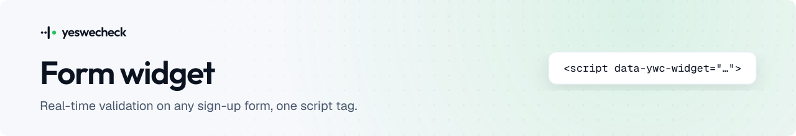

<picture>
  <source media="(prefers-color-scheme: dark)" srcset="../../.github/assets/header-widget-dark.svg">
  
</picture>

<sub><a href="../../README.md">YesWeCheck</a> › <a href="../README.md">Integrations</a> › Form widget · <a href="https://docs.yeswecheck.fr/uk/guides/widget">Full documentation</a></sub>

# Form widget

The widget checks the address as it is typed, suggests a correction for a typo, displays a message and can stop the form from being submitted. It installs with a `<script>` tag and **contains no secret**: the page only carries the widget's public ID.

> [!CAUTION]
> **Never expose an API key in a web page**
> Don't call `POST /v2/email/validate` from the browser with a key: any visitor could read it. The widget is built for this case, with its own protections: origin check, anti-bot proof of work, per-IP and per-device limits.

<a id="install"></a>

## Install

<ol>
  <li>In the dashboard, open <strong>Widgets</strong> and create a widget.</li>
  <li>Link an API key to it and declare your site's domains (<code>yoursite.com</code>, <code>*.yoursite.com</code>). The widget only responds from these domains.</li>
  <li>Set the target field, the trigger, the messages and the appearance. The preview updates live.</li>
  <li>Copy the snippet and paste it into your pages, ideally just before <code>&lt;/body&gt;</code>.</li>
</ol>

```html
<!-- YesWeCheck — real-time email verification -->
<script async src="https://api.yeswecheck.fr/widget/ywc-email-widget.js" data-ywc-widget="YOUR_WIDGET_ID"></script>
```

That's it. On load, the script reads `data-ywc-widget`, fetches its configuration and attaches to the target fields (by default `input[type="email"]`). A change made in the dashboard applies on the next page load, without touching the snippet.

## What the visitor sees

- A visual state on the field: checking, valid, to check, invalid.
- A message suited to the case: disposable address, generic account, noreply address, accept-all domain, inconclusive server…
- "Did you mean john@gmail.com?" on a typo, with one-click correction.
- Domain suggestions while typing after the `@` (gmail.com, outlook.com…), adapted to the country.

## Main settings

| Setting | Effect |
|---|---|
| Target field | CSS selector of the fields to watch |
| Trigger | When leaving the field (default) or while typing, with a delay |
| Messages | Text for each state and each case |
| Appearance | Colours, icons, theme; each verdict case is placed in a category with its label and its action |
| Domain suggestions | Enabled by default, country detected from the browser; they count towards the [key's call limit](../../docs/rate-limits.md#limits-per-api-key) |
| Captcha (Altcha) | On by default. Proof of work solved by the browser, invisible to the visitor; for every verification or only when SMTP is involved |
| Abuse protection | Per-IP, per-device and per-day limits; degrade (verification without SMTP) or block beyond them |

<a id="block-form-submission"></a>

### Block form submission

Each verdict category has an action: **let through**, **warn** or **block**. By default, everything goes through. When a category is set to "block", the widget prevents the form from being submitted while the address entered stays in that category.

Blocking is deliberately lenient when in doubt: it only acts on a result obtained for the value currently entered. If the API does not respond, the form is submitted.

To disable blocking on a specific page or form without touching the configuration, add the `data-ywc-no-gating` attribute to the `<script>` tag, the `<form>` or the field:

```html
<form action="/signup" method="post" data-ywc-no-gating>
  <input type="email" name="email" required />
</form>
```

> [!WARNING]
> **Always re-verify on the server**
> The widget improves input, it does not replace a server-side check: a bot can submit your form without running the JavaScript. For a decision that matters (account creation, order), also verify the address from your backend with a [server key](../../docs/guides/signup-validation.md).

<a id="smtp-and-credits"></a>

## SMTP and credits

The **key linked to the widget** decides whether SMTP runs, as for any call made with a key. Each conclusive SMTP verification made by the widget consumes one credit. To limit spending:

- set a daily **credit cap** on the widget's key;
- keep the **SMTP per day** limit of the abuse protection (200 by default);
- keep the trigger on "when leaving the field" rather than "while typing".

<a id="security-at-a-glance"></a>

## Security at a glance

| Protection | Role |
|---|---|
| No secret in the page | The snippet only contains the widget's public ID |
| Allowed domains | The widget refuses to respond from an undeclared site (`403`) |
| Altcha captcha | Proof of work computed by the browser, verified by the server |
| Per-IP and per-device limits | Beyond them: degraded verification without SMTP, or `429` refusal with `Retry-After` |
| Blocklist | IP addresses banned from the dashboard (`403`) |
| Enumeration detection | `DUPLICATED_SUBMITTER` signal when the same source submits many different addresses |

### The widget ID is not a secret

The ID appears in your page's code: anyone can read it. In a browser, the domain check stops another site from using it, but a script run outside a browser can imitate your site's origin. What really limits usage are the server-side protections: proof of work on every verification, per-IP and per-device limits, the [key's call limit](../../docs/rate-limits.md#limits-per-api-key) and the key's credit cap. Set them according to your traffic.

<a id="content-security-policy-csp"></a>

## Content Security Policy (CSP)

If your site enforces a CSP, allow the API domain for the script and for the calls:

```http
Content-Security-Policy: script-src 'self' https://api.yeswecheck.fr; connect-src 'self' https://api.yeswecheck.fr; style-src 'self' 'unsafe-inline'
```

The widget injects a small stylesheet into the page, hence `style-src 'unsafe-inline'`. The captcha uses the browser's Web Crypto API, available only over HTTPS.

<a id="troubleshooting"></a>

## Troubleshooting

| Symptom | Likely cause |
|---|---|
| Nothing happens | The script is not loaded (CSP, blocker), or no field matches the selector. Check the console: messages start with `[YesWeCheck Widget]`. |
| `403` in the network tab | The page's domain is not declared on the widget's key, or the IP is on the blocklist. |
| `403` locally (`localhost`) | A local page is not a domain you can declare. Test with the dashboard preview, or on a declared domain (your staging site, for example). |
| `404 widget not found` | Wrong ID, or widget deleted or disabled. |
| `429` | Abuse limit reached for this IP or device, or rate cap on the widget routes (60 verifications and 120 configuration loads per minute per IP), or the [call limit of the key](../../docs/rate-limits.md#limits-per-api-key) linked to the widget, across all visitors. |
| The captcha fails | Page served over HTTP: the proof of work requires HTTPS. |
