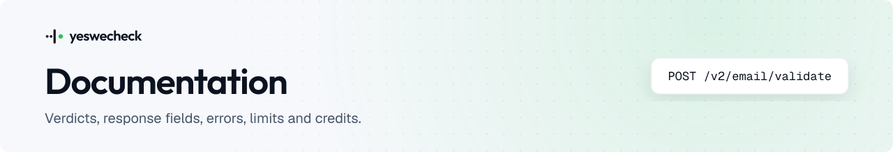

<picture>
  <source media="(prefers-color-scheme: dark)" srcset="../.github/assets/header-docs-dark.svg">
  
</picture>

# OpenAPI specification

[`openapi.yaml`](openapi.yaml) describes every route of the YesWeCheck API you can call with an API key or without authentication (OpenAPI 3.0.3).

| Tag | Routes |
|---|---|
| Validation | `POST /v2/email/validate` |
| Enrichment | `POST /v2/email/enrich` |
| Suggestions | `POST /v2/email/suggest/domain` · `GET /v2/email/suggest/domain/countries` · `POST /v2/email/suggest/typo-domain` · `POST /v2/email/suggest/localpart` · `POST /v2/email/suggest-firstname` · `POST /v2/email/suggest-lastname` |
| Platform | `GET /v2/me` · `GET /v2/billing/catalog` · `GET /health` |

## Use it

- **Explore it** in the interactive reference at [docs.yeswecheck.fr](https://docs.yeswecheck.fr/uk/reference/yeswecheck-api).
- **Import it** into Postman, Insomnia, Bruno or Hoppscotch to try every route.
- **Generate a client** in your language, for example with [OpenAPI Generator](https://openapi-generator.tech):

```bash
npx @openapitools/openapi-generator-cli generate \
  -i https://raw.githubusercontent.com/YesWeCheck/yeswecheck/main/openapi/openapi.yaml \
  -g go -o ./yeswecheck-go
```

> [!TIP]
> Send `Accept-Language: en-GB` with your requests to receive error messages in English. Always branch on the machine-readable `code`, never on the message.
