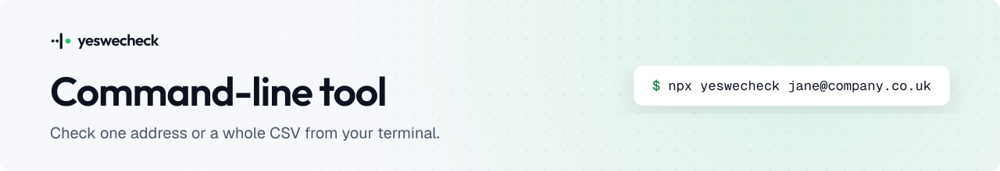

<picture>
  <source media="(prefers-color-scheme: dark)" srcset="https://raw.githubusercontent.com/YesWeCheck/yeswecheck/main/.github/assets/header-cli-dark.svg">
  
</picture>

<p align="center">
  <a href="https://www.npmjs.com/package/yeswecheck"></a>
  <a href="https://github.com/YesWeCheck/yeswecheck/actions/workflows/ci.yml"></a>
  
</p>

<p align="center">
  
</p>

Verify email addresses from your terminal: one address, a handful, or a whole CSV file. Nothing to install with `npx`.

## Quickstart

```bash
export YWC_API_KEY=ywc_live_…   # free key: https://app.yeswecheck.fr/uk/register?src=cli
npx yeswecheck jane.doe@company.co.uk
```

## Commands

| Command | What it does | Credits |
|---|---|---|
| `yeswecheck <email> [more…]` | Verifies each address and explains the verdict | 1 per conclusive mailbox check |
| `yeswecheck check <file.csv>` | Verifies every address of a CSV or TXT file and writes `<file>.checked.csv` | Same, per unique address |
| `yeswecheck typo <email\|domain>` | Suggests a fix for a mistyped domain | Free |
| `yeswecheck me` | Shows your balance, key settings and caps | Free |

### Options

| Option | Description |
|---|---|
| `-k, --key <key>` | API key (default: `YWC_API_KEY`) |
| `-o, --out <file>` | `check`: output file |
| `--column <name\|n>` | `check`: email column, by header or number (auto-detected otherwise) |
| `--concurrency <n>` | `check`: parallel requests, 1–8 (default 3) |
| `-y, --yes` | `check`: skip the confirmation prompt |
| `--country <code>` | Reference country, e.g. `GB` |
| `--json` | Machine-readable output, for scripts and `jq` |

## Checking a CSV file

```bash
npx yeswecheck check customers.csv
```

- The separator (`,` `;` or tab) and the email column are detected automatically.
- Duplicates are verified once, and every original column is kept.
- Four columns are added: `ywc_result`, `ywc_score`, `ywc_reason` and `ywc_suggestion` (the typo fix, if any).
- Before starting, the tool shows how many credits the file may use and asks for confirmation.
- Requests are paced to stay within the API's rate limit.

> [!TIP]
> For lists of tens of thousands of addresses, the dashboard's [bulk processing](../../docs/guides/bulk-lists.md) is faster and gives you a PDF report.

## Exit codes

`0` success · `1` error (bad key, network, cancelled) · `2` at least one address is `invalid`, handy in scripts:

```bash
npx yeswecheck "$EMAIL" > /dev/null || echo "Please check this address"
```

## Licence

[MIT](LICENSE) © YesWeCheck
