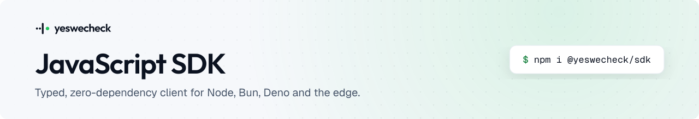

<picture>
  <source media="(prefers-color-scheme: dark)" srcset="https://raw.githubusercontent.com/YesWeCheck/yeswecheck/main/.github/assets/header-js-dark.svg">
  
</picture>

<p align="center">
  <a href="https://www.npmjs.com/package/@yeswecheck/sdk"></a>
  <a href="https://github.com/YesWeCheck/yeswecheck/actions/workflows/ci.yml"></a>
  
  
</p>

<p align="center">
  <a href="#quickstart">Quickstart</a> ·
  <a href="#api">API</a> ·
  <a href="#errors">Errors</a> ·
  <a href="https://docs.yeswecheck.fr/uk">Docs</a> ·
  <a href="https://app.yeswecheck.fr/uk/register?src=github-js">Get an API key</a>
</p>

The official client for the [YesWeCheck](https://yeswecheck.fr/uk) email verification API. Typed end to end, zero dependencies, and safe by default: it never replays a request that may have used a credit.

Works on **Node.js 20.19+**, **Bun**, **Deno**, and edge runtimes with `fetch` (Cloudflare Workers, Vercel Edge).

## Quickstart

```bash
npm install @yeswecheck/sdk
```

```ts
import { YesWeCheck, suggestedEmail } from "@yeswecheck/sdk";

const ywc = new YesWeCheck(); // reads YWC_API_KEY

const res = await ywc.validate("jane.doe@gmial.com");

switch (res.result) {
  case "valid":   /* deliverable, no risk signal */ break;
  case "risky":   /* deliverable but disposable, no-reply, lookalike… */ break;
  case "invalid": /* will not receive mail */ break;
  case "unknown": /* no conclusion from the mail server: never billed */ break;
}

const fix = suggestedEmail(res); // "jane.doe@gmail.com" → show "Did you mean…?"
```

> [!IMPORTANT]
> Keep your API key on the server. The SDK refuses to run in a browser, where the key would be visible to anyone. For forms, use the [YesWeCheck widget](https://docs.yeswecheck.fr/uk/guides/widget): one script tag, no key in the page.

## API

| Method | Endpoint | Credits |
|---|---|---|
| `validate(email, { country?, smtpTimeout? })` | `POST /v2/email/validate` | 1 if your key has SMTP **and** the verdict is not `unknown` |
| `enrich(email, { country? })` | `POST /v2/email/enrich` | Free |
| `suggestDomain(partial, { country?, count?, type? })` | `POST /v2/email/suggest/domain` | Free |
| `suggestDomainCountries()` | `GET /v2/email/suggest/domain/countries` | Free |
| `suggestTypo(emailOrDomain)` | `POST /v2/email/suggest/typo-domain` | Free |
| `suggestLocalpart(firstName, lastName, { domain?, … })` | `POST /v2/email/suggest/localpart` | Free |
| `suggestFirstName(query, limit?)` / `suggestLastName(query, limit?)` | `POST /v2/email/suggest-firstname` · `-lastname` | Free |
| `me()` | `GET /v2/me`: balance, key settings and usage | Free |
| `catalog()` | `GET /v2/billing/catalog` (no key needed) | Free |
| `health()` | `GET /health` (no key needed) | Free |

Helpers: `isDeliverable(res)` (`valid` or `risky`), `suggestedEmail(res)` (the typo fix to offer your user), `hasWarning(res, "DISPOSABLE_EMAIL")`.

Every response is fully typed (`ValidationResponse`, `Features`, `Warning`, `MeResponse`…), straight from the [OpenAPI specification](../../openapi/openapi.yaml).

### Options

```ts
const ywc = new YesWeCheck({
  apiKey: "ywc_live_…",   // default: process.env.YWC_API_KEY
  timeoutMs: 30_000,      // a mailbox check can take a few seconds
  maxRetries: 2,          // rate limits and temporary errors
  maxRetryDelay: 60,      // longest Retry-After waited for automatically (s)
  language: "en-GB",      // language of error messages
  fetch: customFetch,     // tests, proxies
});
```

## Errors

```ts
import { YesWeCheckApiError, YesWeCheckConnectionError } from "@yeswecheck/sdk";

try {
  await ywc.validate(email);
} catch (err) {
  if (err instanceof YesWeCheckApiError) {
    err.status;      // 401, 402, 403, 429…
    err.code;        // "INSUFFICIENT_CREDITS", "API_KEY_BUDGET_EXCEEDED"… branch on this
    err.retryAfter;  // seconds, when the API says so
  } else if (err instanceof YesWeCheckConnectionError) {
    err.timedOut;    // true if the SDK's timeout fired
  }
}
```

| Situation | What the SDK does |
|---|---|
| `429` rate limit | Waits for `Retry-After` and retries (the request was refused before any processing, so nothing was billed) |
| `429 API_KEY_BUDGET_EXCEEDED` | Throws straight away: the key's own cap is reached until the next window |
| `502`/`503`/`504`, network error | Retries free endpoints with backoff; **never** replays `validate`, which may already have used a credit |
| `401`, `402`, `403`, `400` | Throws a typed `YesWeCheckApiError` |

See [Errors](../../docs/errors.md) for every code.

## Licence

[MIT](LICENSE) © YesWeCheck
