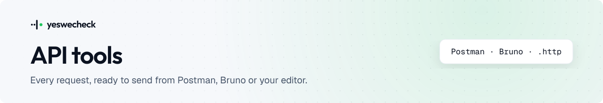

<picture>
  <source media="(prefers-color-scheme: dark)" srcset="../.github/assets/header-tools-dark.svg">
  
</picture>

Every request of the API, ready to send from the tool you already use: 12 requests in four folders (Verify, Suggest, Account, Status), with a description of each and its cost in credits.

<table>
  <tr>
    <td width="72" align="center"></td>
    <td><b><a href="postman/yeswecheck.postman_collection.json">Postman</a></b><br>A collection file, with key and base URL as variables.</td>
  </tr>
  <tr>
    <td align="center"></td>
    <td><b><a href="bruno/">Bruno</a></b><br>A plain-text collection you can keep in Git, with a <i>Production</i> environment.</td>
  </tr>
  <tr>
    <td align="center"></td>
    <td><b><a href="requests.http">requests.http</a></b><br>For the REST Client extension of VS Code and the HTTP client of JetBrains IDEs.</td>
  </tr>
</table>

You need an API key: [get one for free](https://app.yeswecheck.fr/uk/register?src=github-tools) (100 credits included). Only **Verify an address** can use a credit; every other request is free.

## Postman

1. In Postman, choose **Import**, then paste this link:

   ```text
   https://raw.githubusercontent.com/YesWeCheck/yeswecheck/main/tools/postman/yeswecheck.postman_collection.json
   ```

2. Open the collection, go to **Variables** and paste your key into `apiKey`.
3. Send **Verify › Verify an address**. Its tests check the status and the verdict.

The key is sent as a Bearer token set once on the collection. **Plan catalogue** and **API status** need no key.

## Bruno

1. Download or clone this repository.
2. In Bruno, choose **Open Collection** and select the [`tools/bruno`](bruno/) folder.
3. Select the **Production** environment, and set `apiKey`. It is a secret variable: Bruno keeps its value on your machine, never in the collection files.

From a terminal, with the [Bruno CLI](https://docs.usebruno.com/bru-cli/overview):

```bash
cd tools/bruno
bru run --env Production --env-var apiKey=$YWC_API_KEY
```

## requests.http

**VS Code:** install the [REST Client](https://marketplace.visualstudio.com/items?itemName=humao.rest-client) extension, start VS Code with `YWC_API_KEY` in its environment, open [`requests.http`](requests.http) and click **Send Request** above any request.

**JetBrains IDEs** (IntelliJ IDEA, WebStorm, PhpStorm, PyCharm): open the file, put your key on the `@apiKey = …` line at the top, and click the run icon next to any request. Don't commit the file with your key in it.

## Good to know

- Every request sends `Accept-Language: en-GB`: without it, error messages are in French.
- The responses are described field by field in the [docs](../docs/response.md) and the [OpenAPI specification](../openapi/).
- Prefer code? See the [SDKs](../README.md#sdks-and-cli) and the [framework recipes](../examples/).
